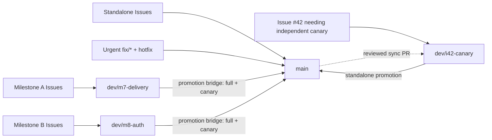

# CSARC Repo Template

[繁體中文](README.md)

Cyber-Arch's updatable repository foundation. A new project, an adopted project, and each policy update get a preview and verification before a PR merges them. Use the common workflow alone, or add Python, Rust, TypeScript, and Go independently.

| Item | Current status |
| --- | --- |
| Template version | v0.45.0<!-- x-release-please-version --> |
| Supported languages | Python, Rust, TypeScript, Go (independently multi-selectable; choosing none uses only the common workflow) |
| repo-site presentation template version | 1.1.0 |
| repo-site render engine version | 1.1.0 |

> [!IMPORTANT]
> Milestone 13 is expanding the repo site and the adoption experience. Only reviewed workflows under `.github/workflows/` run today; the rest stay archived. See [CI/CD settings](docs/index.html#testing) for each stage's enabled status.

| Choose directly | Formally available today |
| --- | --- |
| Language | Python, Rust, TypeScript, Go are independently multi-selectable; choosing none uses only the common workflow |
| Branching | Each delivery batch gets its own development branch, changes merge straight to `main`, or work first collects on `dev` |
| Template configuration | Create and adopt write your choices to `.csarc/config.yml`; later template updates read the same file, so no setting is duplicated elsewhere |
| Shared capabilities | Issue and pull request forms, AI working rules, automated verification, dependency security, version records, and template updates |

README is the compact entry point to the [repo-site](docs/index.html). The two keep public facts aligned but need not share text or structure. This repository and its [GitHub Pages repo-site](docs/index.html) are currently publicly readable. `noindex`/`robots.txt` only reduce search indexing; they cannot restrict reading or sharing. See [Issue #79](https://github.com/Innoguard-Cyber-Arch/csarc-repo-template/issues/79) for the interim record and [Issue #425](https://github.com/Innoguard-Cyber-Arch/csarc-repo-template/issues/425) for the pending hosting/access-control decision.

> **What this document is for:** README tells a general adopter what this template is, whether to use it, how to start, and where to learn more. To contribute to this repository, read [`AGENTS.md`](AGENTS.md) (the executable working rules). For the "why" behind these choices, read the [repo-site appendix](docs/index.html). Each document owns one layer, so nobody maintains the same rules twice.

## Table of contents

- [Overview](#overview)
- [Quick start](#quick-start)
- [Prerequisites](#prerequisites)
- [Technology and layout](#technology-and-layout)
- [Development and verification](#development-and-verification)
- [Configuration and secrets](#configuration-and-secrets)
- [Release and operations](#release-and-operations)
- [Template updates](#template-updates)
- [Owners and support](#owners-and-support)
- [License](#license)

## Overview

This repo maintains a Copier template, shared CI, security checks, and GitHub configuration drafts. `template/` is what downstream repositories receive; the root of this repository applies the same rules to itself.

Available today: a common CI/CD baseline, independently selectable Python, Rust, TypeScript, and Go language modules, Issue/spec, PR checks, and verification. `documentation_mode` selects the full template plus content, content management only, or no documentation management. `documentation_languages` selects the Traditional Chinese/English entry points and the primary language. The `container` switch adds the Docker starter. Same-PR version materialization, GitHub Releases, packaging, checksums, and SBOMs stay candidates until a default-branch live run proves them. Registry publishing and general deployment stay disabled. The settings script reports the account plan separately from live API capability.

## Quick start

Git, GitHub CLI 2.93.0 or newer, and uv are common requirements. Rust also needs rustup; TypeScript also needs Node 24+ and pnpm 11; Go also needs the pinned Go toolchain. Selecting none of the four language modules (`language: ci`) needs no extra language toolchain. CSARC delivers a CI/CD template and governance workflow; Python only runs the thin init/adopt/update CLI. `uvx --python 3.14` acquires an isolated runtime per invocation, so you need no pre-installed or globally maintained Python. On Windows, run this from WSL2. [Prerequisites](#prerequisites) below lists the macOS/Windows install commands and the full tool list for the "adopting a project" and "template contributor" situations.

By default, `scripts/resolve-cache-root` points at a user-level cache shared across worktrees: `~/Library/Caches/csarc` on macOS. On Linux/WSL2 it follows the XDG Base Directory convention: `$XDG_CACHE_HOME` first, then `~/.cache/csarc`. `uv`, `pnpm`, and the pinned-version tool install scripts read that location through `scripts/resolve-cache-root` (`scripts/install-gitleaks`/`install-actionlint`/`install-shellcheck`/`install-osv-scanner`/`install-hugo`). They need no extra setup to share verified downloads across worktrees and across the temporary candidate directories that `csarc adopt --finalize` produces. If the shared location is missing or not writable, it fails safe back to a repo-local `.cache/`. This is only a local performance optimization: verification correctness and results do not change, but downloads repeat and take longer without a shared cache. To use a different persistent path by team convention, add `export CSARC_CACHE_ROOT="<path>"` to your shell profile (e.g. `~/.zshrc`, `~/.bashrc`, or `~/.config/fish/config.fish`).

Open the Codex/agent workspace from the actual Git root. From a parent directory, a subdirectory's `AGENTS.md` may not auto-load. Before you start, run `test "$(git rev-parse --show-toplevel)" = "$(pwd -P)"` in the working directory. If it fails, switch to the printed Git root; do not copy the instructions to a parent directory.

```bash
uvx --python 3.14 --from 'git+https://github.com/Innoguard-Cyber-Arch/csarc-repo-template.git@<approved-full-commit-sha>' csarc init ./my-project
uvx --python 3.14 --from 'git+https://github.com/Innoguard-Cyber-Arch/csarc-repo-template.git@<approved-full-commit-sha>' csarc adopt
uvx --python 3.14 --from 'git+https://github.com/Innoguard-Cyber-Arch/csarc-repo-template.git@<approved-full-commit-sha>' csarc update --check --json
```

`<approved-full-commit-sha>` comes from the pinned prompt for an approved GitHub Release; never type the placeholder text literally. `init`/`adopt` ask only for values the repository cannot decide uniquely ([SPEC-009 §9](docs/specs/SPEC-009-project-settings.md)). On a terminal, init asks for the purpose, languages, license, copyright holder, documentation language, and work mode. The work mode is `solo-local` by default, `solo-hosted`, `team`, or `custom`; it only expands into overridable settings, and its name is never saved. Adopt first confirms what it detected, then asks for `governance_mode` and the work mode. The CLI never asks again for detected values or `--data` values. With `--non-interactive`, a missing required input such as `project_description`, `copyright_holder`, or init's `languages` stops before rendering, with one line that lists the needed `--data`; `--preset` selects the work mode. With `admin_bypass: off` (or `beta-only`), the CLI first reads the collaborator list. If it observes no other maintainer, the plan stops and suggests `--data admin_bypass=always`; an incomplete read needs `--confirm-second-approver`. A public repository's security reporting channel must be a maintainer-approved private entry outside GitHub: an email address, a `mailto:` link, or a non-GitHub `https://` URL. Rendering fails when the channel is missing or points at a GitHub Issue or Discussion. A private or internal repository defaults to the repository's Issue instructions. The CLI never guesses an email address or SLA and never assumes GitHub private vulnerability reporting is enabled. When the GitHub origin is identifiable, the CLI uses the actual repository URL for badges, the clone command, and package metadata. `project_run_command` only describes how the product starts; it is never a verification command. An existing repo can set `project_verification_hook=scripts/verify-skills` to name a repository-relative executable. Only when none is set does it fall back compatibly to `scripts/verify-product`.

Choose any combination of Python, Rust, TypeScript, and Go when you create or adopt. `.csarc/config.yml` stores the result with branching, verification, release, and other template options. This file is each repo's single source of template configuration; a generated repo also stores Copier's source and version in it. To adjust a generated repo, use an update command like `csarc update --data languages=python,rust`. Never create a second profile file elsewhere.

The CLI always verifies the canonical repository's numeric ID, an immutable stable Release, release attestation, tag pointer, and commit signature. It then resolves the GitHub Release into a full commit SHA and shows the plan; any mismatch stops before Copier writes a file. Interactive mode waits for user confirmation; CI or an agent must explicitly pass both `--yes --non-interactive`. The template source is currently public, but the CLI still verifies Release identity through the GitHub API. Install GitHub CLI 2.93.0 or newer and complete `gh auth login` first. The root CLI is not published to PyPI.

## Prerequisites

CSARC has two different situations, and each needs different tools: **using csarc to create or update a project** (a general adopter, or someone adopting an existing repo) and **developing/contributing to `csarc-repo-template`** (a template contributor). Below, each situation lists its required tools with macOS (Homebrew), Windows (winget/Chocolatey), and Linux/WSL2 (Ubuntu, apt) install commands. A tool with no official package-manager package links to its official install script instead. `docs/agent-install.md` is only the agent's automated install contract; it does not cover these human install steps.

### Using csarc to create or update a project

Git, GitHub CLI 2.93.0 or newer, and `uv` are always required. `uvx --python 3.14` creates an isolated runtime per invocation, so you need no global Python. Each language module you choose needs its own toolchain. Selecting none of `languages` (i.e. `language: ci`, explained below) needs no extra language toolchain.

| Tool | When needed | macOS (Homebrew) | Windows (native, winget/Chocolatey) | Linux/WSL2 (Ubuntu, apt) |
| --- | --- | --- | --- | --- |
| Git | Always | `brew install git` | `winget install --id Git.Git -e` | `sudo apt install -y git` |
| GitHub CLI (`gh`) 2.93.0+ | Always required by the csarc CLI; run `gh auth login` after installation | `brew install gh` | `winget install --id GitHub.cli --source winget` (or `choco install gh`) | Use the [official GitHub apt repository](https://github.com/cli/cli/blob/trunk/docs/install_linux.md#debian), not Ubuntu's bundled package |
| uv | Always; even with `ci` selected, a generated project's `./scripts/verify` still runs its check scripts with `uv run --no-project python` | `brew install uv` | `winget install --id=astral-sh.uv -e`; without winget, use the official install script `powershell -ExecutionPolicy ByPass -c "irm https://astral.sh/uv/install.ps1 \| iex"` (see the [uv install docs](https://docs.astral.sh/uv/getting-started/installation/)) | `curl -LsSf https://astral.sh/uv/install.sh \| sh` |
| Node.js 24+ | Only with the `typescript` language module | `brew install node` | `winget install --id OpenJS.NodeJS.LTS -e` | `curl -fsSL https://deb.nodesource.com/setup_24.x \| sudo -E bash -` then `sudo apt install -y nodejs` |
| pnpm 11 | Only with the `typescript` language module | `brew install pnpm` | `winget install -e --id pnpm.pnpm` | `sudo npm install -g pnpm@11` |
| rustup/Cargo | Only with the `rust` language module; **Linux/WSL2 also needs `build-essential` (a system C linker)** | `brew install rustup` (keg-only; the formula no longer ships `rustup-init`, so add `$(brew --prefix rustup)/bin` to `PATH` to finish installing); or the official script `curl --proto '=https' --tlsv1.2 -sSf https://sh.rustup.rs \| sh` | `winget install -e --id Rustlang.Rustup` | `sudo apt install -y build-essential` then `curl --proto '=https' --tlsv1.2 -sSf https://sh.rustup.rs \| sh` |
| Go 1.27.1 | Only with the `go` language module; the generated verifier requires exactly go1.27.1 | Install the `go1.27.1` macOS `.pkg` from the [official Go downloads page](https://go.dev/dl/); do not use `brew install go`, which installs the newest Go rather than the pinned version | Inside WSL2, use the "Linux/WSL2" column | Per the [official Go install guide](https://go.dev/doc/install): `curl -LO https://go.dev/dl/go1.27.1.linux-amd64.tar.gz && sudo rm -rf /usr/local/go && sudo tar -C /usr/local -xzf go1.27.1.linux-amd64.tar.gz`, then add `/usr/local/go/bin` to `PATH` |

On Windows, run the repo and the `csarc` CLI inside WSL2 (Ubuntu). The table's "Windows (native, winget/Chocolatey)" column installs an individual tool natively on Windows (e.g. `git`/`gh` before you enter WSL2). A rustup installed there is not on `PATH` inside the WSL2 Ubuntu shell, so use the "Linux/WSL2 (Ubuntu, apt)" column instead. Install Go only inside WSL2; there is no native Windows path. Inside WSL2, install `gh` from GitHub's official apt repository and confirm `gh --version` is at least 2.93.0. Ubuntu's bundled package is too old for the required Release verification. On Linux/WSL2, Rust also needs `build-essential` (a system C linker), even for a pure-Rust project with no C bindings. Without it, `cargo test` fails at compile time with `error: linker 'cc' not found`. The [repo-site appendix](docs/index.html) has the full guided script for macOS/WSL2 Ubuntu.

### Developing/contributing to `csarc-repo-template` itself

Beyond `uv` and `gh` from the table above, you also need:

- **pnpm 11, rustup/Cargo, Go 1.27.1**: the full `./scripts/verify-template.sh` generates the Python, TypeScript, Rust, and Go language modules in turn and runs each one's native validator (see `tests/test_language_profiles.py`). The representative combination test needs all four toolchains. The daily PR gate `./scripts/verify-fast` usually needs no rustup/Cargo or Go, unless a change triggers the template smoke test. The install commands are the same as in the table above.
- **The repo-site build needs no extra tool.** `scripts/build-repo-site` runs `scripts/build_repo_site.py`, which is pure stdlib Python (see that file's header comment) and no longer depends on Hugo or any external renderer. The `uv` (or a system `python3`) from the table above can rebuild `docs/index.html`/`docs/index.en.html`.
- **gitleaks, actionlint, ShellCheck, OSV-Scanner: no manual install needed.** `scripts/verify-template.sh`/`scripts/verify-fast` call `scripts/install-gitleaks`/`install-actionlint`/`install-shellcheck`/`install-osv-scanner`. These scripts download, checksum-verify, and cache a pinned version on macOS/Linux (including WSL2); only the first run needs network access. Use the commands below only to run these tools on their own, in an editor or locally:

  | Tool | macOS (Homebrew) | Windows (winget/Chocolatey) |
  | --- | --- | --- |
  | gitleaks | `brew install gitleaks` | `winget install --id Gitleaks.Gitleaks` (or `choco install gitleaks`) |
  | actionlint | `brew install actionlint` | `winget install -e --id rhysd.actionlint` (or `choco install actionlint`) |
  | ShellCheck | `brew install shellcheck` | `winget install --id koalaman.shellcheck` (or `choco install shellcheck`) |
  | OSV-Scanner | `brew install osv-scanner` | `winget install Google.OSVScanner` |

- **zizmor: no manual install needed.** It is a `uv` dev dependency in `pyproject.toml` (`zizmor==1.29.0`), installed by `uv sync --locked`; `scripts/verify-stage-github-actions-audit` runs it with `uv run zizmor`.

The full verification entry point is `./scripts/verify-template.sh`. For day-to-day work, use the narrowest `./scripts/verify-fast` or a single `scripts/verify-stage-<name>` first. [`AGENTS.md`](AGENTS.md#commands) and [`docs/ci-policy.md`](docs/ci-policy.md) say when a full local run is needed.

### `language: ci`: the formally supported "no language" option

`copier.yml`'s `languages` (multiselect) deliberately allows you to leave everything unchecked. This equals the legacy single-select field's `language: ci` value. It is a **formally supported, not incomplete or half-finished**, "CI/CD baseline" option, not a temporary "language not yet decided" state. For each module you leave out, Copier's `_exclude` rules in `copier.yml` skip its files and toolchain:

- Not choosing `python`: no `pyproject.toml`, `.python-version`, `src/<package_name>/`, or `tests/` is generated, and no Python project toolchain is needed.
- Not choosing `typescript`: no `package.json`, `.node-version`, `pnpm-workspace.yaml`, `biome.json`, `tsconfig*.json`, `vitest.config.ts`, or `typescript/` is generated, and no Node/pnpm is needed.
- Not choosing `rust`: no `Cargo.toml`, `rust-toolchain.toml`, or `src/lib.rs` is generated, and no rustup/Cargo is needed.
- Not choosing `go`: no `go.mod`, `cmd/`, or `internal/` is generated, and no Go toolchain is needed.
- Choosing none of the four (i.e. `ci`): a generated project's `./scripts/verify` only runs the common checks (secret scanning, dependency checks, workflow lint, policy JSON validation, spec validation, etc.). It runs the existing Python tool scripts only with `uv run --no-project python`. No Python/Node/Rust/Go project package toolchain is needed, but `uv` is still required because these check scripts are written in Python.

This is a separate question from the tools that developing this template repo needs. An adopter of a csarc-generated project can choose only `ci`, with minimal prerequisites (see the table above). A contributor to this template repo needs all four language toolchains. `tests/test_language_profiles.py` generates a project for each of the python/typescript/rust/go profiles and runs its native validator, so the full `./scripts/verify-template.sh` needs all four.

## Technology and layout

| Path | Purpose |
| --- | --- |
| `copier.yml`, `template/` | Questions, shipped files, and post-creation tasks |
| `.csarc/config.yml` | Template configuration shared by root and a generated repo; a generated repo also records Copier's source/version |
| `profiles/catalog.yaml` | Supported languages and version policy |
| `.github/`, `policies/` | This template's own CI and GitHub configuration |
| `scripts/verify-template.sh` | Create, update, language, and supply-chain regression |
| `src/csarc_cli/` | The thin Copier orchestration layer behind `csarc init`/`adopt`/`update` |
| `docs/README.md`, `docs/specs/`, `docs/adr/` | The Durable Project Memory map, Spec-Driven Development (SDD) specs, and Architecture Decision Records (ADR) |
| `site/`, `scripts/build-repo-site` | repo-site content, the pure-Python render engine, styles, and the reproducible single-file build entry point |
| `docs/index.html`, `docs/index.en.html` | The offline-deliverable bilingual generated presentation; currently only `noindex`/`robots.txt` as a temporary safeguard, with no real access control yet |

Python currently baselines on 3.14, uv, Ruff, ty, pytest, and a src layout; CI verifies both the exact lower bound 3.14.0 and the latest 3.14.x. A generated project in minimum mode verifies the chosen version's `.0` lower bound, plus the latest patch of every feature release up to 3.14; it deliberately declares no 3.11 support. Rust baselines on 1.98, `Cargo.lock`, rustfmt, Clippy, `cargo test`, and a release build. TypeScript baselines on Node 24, pnpm 11, Biome, strict TypeScript, and Vitest. Go baselines on a Go 1.27 minimum (`go.mod` writes `go 1.27.0` with no `toolchain` directive), Go 1.27.1 for development and verification, Go modules, gofmt, `go vet`, `go test`, and `go build`; `go.sum` exists only when the module has dependencies.

This template's Durable Project Memory supports SDD, ADR, Test-Driven Development (TDD) regression evidence, and Behavior-Driven Development (BDD) required scenarios together; see [`docs/README.md`](docs/README.md) for the full breakdown and navigation.

## Development and verification

The work model is "SDD → Issue → its own PR"; split a sub-Issue under an Issue only when needed. A Milestone groups a dated delivery: one tracker Issue and several main Issues attached directly (no Feature parent). Main Issues, sub-Issues, and their PRs all belong to the same Milestone. A leaf Issue maps to one native Development branch and one PR, which merges only after CI and human review both pass. The repository Projects tab stays disabled. `.csarc/config.yml` can set a full organization/user ProjectV2 URL (`github_project_url`). Then `csarc issue create` and `csarc issue sync-project` only project each Issue's creation date and Milestone due date onto that Project's Roadmap as UTC dates. After the Issue is closed or Done, the completion date replaces the due date. An empty value calls no Project API. Only stubbed API responses verify the sync, not a live ProjectV2; try it only on a dedicated disposable Project, never the existing Project #1. [`AGENTS.md`](AGENTS.md) is the single authoritative source for the full ruleset (Issue/PR body format, title conventions, relationships, branch and worktree use, closing-keyword restrictions, etc.); this README does not repeat it.

This repo uses delivery mode: `main` is the only permanent branch. Each Milestone uses a short-lived `dev/m*`. An ordinary standalone Issue creates a topic branch from the latest `main` and merges straight back to `main` via PR. Only a documented, genuinely standalone soak/canary uses a one-off `dev/i<issue-number>-<slug>` promotion; an explicit hotfix also targets `main` directly. CI is the portable integration-test layer; an external test environment is the canary layer.

When a Milestone work PR merges into `dev/m*`, an Action re-verifies the same-numbered Issue, the exact source SHA, the target branch, and the Milestone, then closes the Issue. An ordinary standalone work item and a hotfix go straight to `main` and use GitHub's native closing.



When `main` moves forward, it never invalidates unrelated Milestone work and never auto-syncs every branch. Each Milestone's final Promotion PR uses an exact two-parent bridge to include both the delivery source and the then-current `main`, so it needs no final sync PR. A reviewed `sync/main-to-*` PR stays available only for an owner-recorded dependency or a `dev/i*` canary before delivery.

This template's full entry point is `./scripts/verify-template.sh`; a generated project uses `./scripts/verify`. New projects default to `verification_mode: local`. In that mode, a successful fast/full run records self-attested evidence bound to the exact head/tree, base, tier, and scopes. The merge lifecycle revalidates that evidence before an audited admin bypass. That mode generates no hosted CI, PR-governance, Pages, release workflows, or required checks, and claims none. Set `hosted` when you need an independent runner, Pages, or release provenance; GitHub-hosted `verify` then runs the same entry point. This repository stays hosted. Both modes share one risk-owned router and suite with no extra test matrix. Local evidence cannot replace third-party service, deployment, or release provenance. See [`docs/ci-policy.md`](docs/ci-policy.md) for the boundaries.

Dependabot, PR-conditional OSV, and the weekly/manual OSV scan are enabled. The single release workflow is a candidate; it counts as enabled only after a default-branch live run. Dedicated promotion, release handoff, registry publisher, and deployment workflows are not restored; Git, Issues, and PRs preserve their history. Zizmor runs through the active local verification stage. Reviewer assignment (`.github/workflows/governance-comment.yml`) is enabled here and in every generated repo. Generated repositories include the weekly governance-drift schedule (`governance-drift.yml`) by default; to opt out, remove `governance-drift` from `scheduled_checks`. This template's own source repo keeps the same `scripts/check-governance-drift` for local verification, without a separate schedule.

### One-off verification when Actions quota is exhausted

The former routine quota fallback is retired: a GitHub Actions zero-step billing block no longer excuses any required check. An Actions outage uses the governance-switch route, which still requires the required checks, exact-head authorization, and the remote lease. A release never uses local evidence. The complete procedure has one canonical copy in [`docs/ci-policy.md`](docs/ci-policy.md#failure-與-fallback).

When a commit exists, `./scripts/scan-secrets` scans the full reachable Git history. It always scans the current working tree separately, so it never silently skips a deleted or an uncommitted secret. A brand-new project with no `git init` yet can still scan its working tree safely. By default it scans the full history; a large repo that explicitly accepted a narrower range can pass e.g. `--log-opts='--since=2026-01-01'`.

## Configuration and secrets

Creating a repo from GitHub or adopting via Copier copies only files, never repository settings. Before the first release, a newly generated repo's administrator must run `./.csarc/scripts/apply-repository-settings.sh plan`/`apply`/`check` in order. This enables immutable Releases and the other release prerequisites. `check` compares, read-only, CODEOWNERS, the repository (including collaborators-only Issue/PR creation), immutable Releases, GitHub Pages, Actions, `security_and_analysis` (secret scanning, push protection, Dependabot security updates), policy labels, and an effective Ruleset. A fixable difference fails the check. `check` explicitly marks the following as `DEGRADED`, never drift or compliant: administrator-only fields that `GITHUB_TOKEN` cannot read, a Free private Ruleset, a private repo's GitHub Pages, an organization policy restriction, or missing GitHub Advanced Security. Generated repositories run `.github/workflows/governance-drift.yml` weekly by default; to opt out, remove `governance-drift` from `scheduled_checks`. The workflow opens one tracking Issue only for fixable drift and updates it only when the drift body changes. This template's own source repo keeps only the same local checker, without a separate schedule. In hosted mode, a non-draft PR gets a best-effort review request from a current non-author collaborator with `maintain` or `admin` permission. Local mode generates no reviewer workflow. The "Identify the GitHub plan first" section on the [repo-site appendix](docs/index.html) describes how `apply`/`check` and review behave under each GitHub plan.

`admin_bypass` decides whether an administrator may self-review with exact-head authorization. It defaults to `off`; you can limit it to beta or explicitly set it to `always`. `copilot_review: allowed` lets a clean exact-head Copilot review count as evidence. Copilot entitlement and quota are live capabilities, never inferred from a Free or Team plan name. Unavailable Copilot, an old head, findings, or unresolved threads fall back to peer approval or configured administrator authorization. See [`docs/ci-policy.md`](docs/ci-policy.md) "Copilot 審核模式（#752）".

`.csarc/config.yml` uses `governance_mode: managed|observe` to choose whether to apply or only observe supported platform policy. `lifecycle` selects Issue/Milestone side effects and does not disable required checks. The settings file keeps only user intent that cannot be safely reconstructed ([SPEC-009](docs/specs/SPEC-009-project-settings.md)). The name, description, and license come from the product manifest and `LICENSE`. Plan, visibility, token permission, Actions billing, Copilot, and Pages are live `allowed`/`blocked`/`unknown` observations, not settings.

When a generated repo selects `template-update` in `scheduled_checks`, it also gets `template-update.yml`. `schedule` (every Monday)/`workflow_dispatch` triggers it, with `contents: read` + `issues: write` and a 10-minute timeout. It only calls `scripts/check-template-update` to create or update a notification Issue; it never applies or merges a change automatically. A public template source needs no secret. Only when `_src_path` points at a private GitHub repository do you need a `CSARC_TEMPLATE_READ_TOKEN` repository secret. Scope it to Contents read on that source repository only. Only `schedule`/`workflow_dispatch` can read it, never a `pull_request` workflow. This template repo is the source itself, so it neither consumes nor schedules it.

`container: true` (Issue #554) creates the Dockerfile, compose starter, and read-only, non-pushing build-and-scan workflow. Documentation has its own single switch. `template-and-content` always creates portable HTML and render checks. Only `verification_mode: hosted` adds an enabled Pages policy and a deployment workflow, which runs only for `docs/**` changes or manual dispatch. `content-only` manages only project-owned Markdown/README; `off` leaves documentation alone. `documentation_languages` separately sets the primary language and whether to maintain both English and Traditional Chinese entry points. When Pages is unavailable or hosted mode is not selected, the site stays usable offline, and nothing reports it as deployed.

The CLI suggests optional integrations (Renovate) and SAST enablement from the detected platform capability and plan. An adopter never has to create a PAT or an extra GitHub App. `csarc init`/`adopt`/`update` first show a read-only preflight result. The current permission puts each optional integration into one of `available`/`request-owner`/`fallback`. That state decides whether you can open the [Renovate App install page](https://github.com/apps/renovate/installations/new) directly. This preflight never enables the release pipeline itself. See the appendix for the full capability matrix and the Fleet governance trigger thresholds.
Actions credentials live in GitHub Secrets/Variables; only the local runtime uses an uncommitted `.env`. Never write a token, private key, or real password into the repo. `./scripts/verify-template.sh` only proves static and synthetic verification. A historical live-integration or artifact-consumption run only proves that commit at that time; it is not a current capability. See [`docs/live-integration.md`](docs/live-integration.md) and [`docs/artifact-consumption.md`](docs/artifact-consumption.md) for the archived evidence and future restoration conditions.

GitHub Pages currently serves `docs/index.html` publicly, with no login or other access restriction. `noindex`/`docs/robots.txt` can reduce indexing but cannot restrict reading or sharing. See the appendix's "Access control decision" section, the interim record in [Issue #79](https://github.com/Innoguard-Cyber-Arch/csarc-repo-template/issues/79), and current planning in [Issue #425](https://github.com/Innoguard-Cyber-Arch/csarc-repo-template/issues/425). Before you make the repository private again, inventory the Issues, pull requests, and commits created while it was public. Treat any discovery of sensitive information as a separate security incident; do not assume that a visibility change erases exposure.

## Release and operations

Four concepts stay distinct. Version intent describes compatibility impact. An official version writes the manifest, package metadata, and CHANGELOG together into one reviewed commit. A release creates an immutable tag, GitHub Release, artifacts, and evidence. Delivery sends verified work into the authoritative branch or to users. Deploying to a real environment is out of this template's scope.

All release-worthy CSARC-owned work materializes its exact version and CHANGELOG in the original delivery PR. Milestone work materializes beta before it merges to `dev/m*`; Milestone promotion, standalone work, and hotfixes materialize stable before they merge to `main`. While the PR is still draft, the agent updates from the current base and runs `python3 scripts/release_policy.py prepare-candidate --sha HEAD --phase <beta|stable>`. It then puts the generated release surfaces in one final release-only commit. CI and `pr_lifecycle.py` reconstruct the expected tree and block a missing or stale candidate. After merge, `release.yml` only publishes and verifies the tag, GitHub Release, artifacts, checksum, and SPDX SBOM; it never opens a second version PR.

| Capability | Current status | How it works today |
| --- | --- | --- |
| A PR's SemVer intent | Active | `fix`/`revert` is patch, `feat` is minor, `!` is major, everything else is no-release |
| Official version and CHANGELOG | Candidate | The final release-only commit in the delivery PR carries them; CI and the merge lifecycle verify the exact tree |
| Tag / GitHub Release | Candidate/Blocked | Published by the shared publisher after the same-PR candidate merges; awaiting a default-branch live run |
| Checksum / SBOM | Candidate | `release_bundle.py` creates, downloads, and re-verifies the exact-tag artifact in the same run; awaiting a live run |
| Production-side attestation | Removed | [#439](https://github.com/Innoguard-Cyber-Arch/csarc-repo-template/issues/439) found zero active consumers and removed the configuration surface -- not left as optional |
| Consumer-side attestation verification | Conditional | Independent of the producer-side configuration above; consumers still use the existing verification contract |
| PyPI / npm / GHCR / Go module proxy | Not applicable | Root publishes to no registry; a generated project only publishes GitHub Release artifacts and requires no long-lived token; Go is not published to a module proxy and ships no prebuilt binaries |
| Production deployment | Not applicable | Defined by the consuming product: environment, health checks, approval, and rollback |

See [`docs/adr/release-security-and-dependencies.md`](docs/adr/release-security-and-dependencies.md) for the full current state, the historical Action disposition, best-practice sources, and the re-enablement threshold.

## Template updates

[`docs/pilot-adoption.md`](docs/pilot-adoption.md) collects real, repeatable adoption steps, acceptance evidence, and known platform limitations. An existing private, CI-only consuming repo completed a v0.2.4 adoption and a v0.3.1 update, which proves the shared adopt, update, and live CI paths. Python, Rust, and TypeScript each reached beta through a reproducible create, existing-repo adoption, update, and native-toolchain verification. Go reached beta through the same reproducible create, adoption, update, native, and hosted verification evidence, without a dedicated consuming repo yet. Selecting multiple modules at once does not form a separate profile.

All three paths below use an approved GitHub Release. The CLI only accepts `Innoguard-Cyber-Arch/csarc-repo-template` (repository ID `1340899393`). It confirms that the Release is published, not draft, immutable, and attested, points to an unmoved tag, and has a valid commit signature. Public versions are stable `X.Y.Z` and beta `X.Y.Z-beta.N`. Latest stable is the default; `--channel beta` is an explicit opt-in. `early` and `formal` are project-level declarations, not version suffixes. Only after verification does the CLI show the full commit SHA, pinned install guide, settings, file classifications, and conflict risk. On success it writes `.csarc/provenance.json`; any source or provenance drift stops it.

### Create a new repo

```bash
uvx --python 3.14 --from 'git+https://github.com/Innoguard-Cyber-Arch/csarc-repo-template.git@<approved-full-commit-sha>' csarc init ./my-project
```

### Adopt an existing repo

Run this on the existing repo's own work branch. `project_mode=existing` preserves the original `pyproject.toml`, `package.json`, product code, tests, specs, and site content.

```bash
git switch -c chore/<issue-number>-adopt-csarc-template
uvx --python 3.14 --from 'git+https://github.com/Innoguard-Cyber-Arch/csarc-repo-template.git@<approved-full-commit-sha>' csarc adopt
uvx --python 3.14 --from 'git+https://github.com/Innoguard-Cyber-Arch/csarc-repo-template.git@<approved-full-commit-sha>' csarc adopt \
  --apply-plan ../<repo>-csarc-adoption-report/csarc-adoption-plan.json
```

With documentation enabled, an existing repository must first create and commit a regular, product-owned `README.md`. When documentation is explicitly unmanaged, pass `--data documentation_mode=off`; README then stays out of the adoption plan.

`code_owner` is empty by default, so no CODEOWNERS file is generated unless you choose an owner during preview. Use `--data code_owner=@<user>` for a personal repository or `--data code_owner=@<organization>/<team>` for an organization repository. For a repository already connected to GitHub, the CLI verifies that the user or team has write-or-above access. Adoption stops when the organization does not match the repository owner, or the owner is confirmed missing or unwritable. `repository_url` comes from the GitHub origin or `GH_REPO`, never from `code_owner`. A local repository without a remote can still produce a plan, but the CLI reports a configured owner as `unknown`. You must then pass `--data repository_url=https://github.com/<owner>/<repository>`, even with `documentation_mode=off`. Migration (#1061): earlier releases defaulted `code_owner` to the template organization's team and derived `repository_url` from it. `csarc update` keeps every owner already saved in `.csarc/config.yml`, and keeps that former default for answers that predate the question. To change it, pass `--data code_owner=` or another owner. After you push, run the generated `./.csarc/scripts/apply-repository-settings.sh plan`, `apply`, and `check`. These commands verify access but never grant it, so repository settings fail closed when the CODEOWNER lacks access.

`adopt` defaults to a dry run; an explicit `--dry-run` still works. It only writes the [SPEC-008](docs/specs/SPEC-008-lifecycle-report-format.md) report set outside the repo: the machine-readable plan `csarc-adoption-plan.json`, `csarc-adoption-report.json` as the only source, and `csarc-adoption-report.md` rendered only from that JSON (replacing the old `csarc-adoption-dry-run.md`). It does not modify the repo or run a target-owned helper or product hook. `update` writes the same format to `../<repo>-csarc-update-report/` as `csarc-update-plan.json`, `csarc-update-report.json`, and `csarc-update-report.md`. The report format has its own version number (currently `2.3.0`, i.e. `LIFECYCLE_REPORT_FORMAT_VERSION`, recorded in the report file). The Markdown always has 9 English H2 headings: `Items requiring your decision`, `Snapshot`, `Summary of file changes`, `Impact analysis`, `File changes`, `Settings`, `Product state`, `Verification`, and `Next steps`. If a project receives the writing guides for the first time or receives a new version, a last `Writing guide` section lists the project-owned README and `docs/` files and recommends a review against the guides. It changes no file, appears once for each guide version, and does not appear with `documentation_mode: off`. It lists file-change counts by action, impact analysis, a read-only inventory of existing GitHub Issue Types and labels with suggested mappings, and items that need a user decision. The default model uses `Bug`/`Feature`/`Task` for Issue work types. Lowercase `bug`/`enhancement`/`documentation` stay PR classifications and the fallback when native Issue Types are unavailable; documentation keeps the `documentation` label alongside `Task`. Pass `work_item_mapping_review=accept-safe` to accept the safe aliases together, or `review-individually` to record that you checked every suggestion. Ambiguous custom labels are always preserved. Adoption never renames or deletes remote labels, and repository settings still require the separate plan/apply/check flow. A trial adoption and the completed adoption update the same report. After a successful apply, the CLI rewrites it in the replayed plan's directory, marks it `applied`, and binds it to the approved plan digest. An unapplied or failed run keeps its previous status, and no second file is produced. If every dirty path is an unstaged tracked modification that the plan explicitly lists as `preserve`, the CLI builds and verifies the candidate from the original bytes, so the same plan can be applied. Any other dirty state can only be reviewed. The plan locks the target HEAD, full working-tree state, Release full SHA, answers, GitHub metadata suggestion snapshot, and output digest. After approval and before the real write, the CLI inventories the metadata again; any drift stops it. Only after you approve `--apply-plan` does the CLI rebuild the candidate in a staged clone, run verification and a patch check, and modify the target repo. README/CHANGELOG stay project-owned, and `.gitignore` uses an ordered union. `AGENTS.md` only updates the CSARC-managed block, and a product's existing `release.yml` stays separate from `csarc-release.yml`.

At adopt time, `--data project_verification_hook=scripts/verify-skills` can name the product verification. That value must be an existing, executable, repository-relative file. The CLI never parses it through a shell, and it must not resolve to or indirectly call the canonical `scripts/verify`. Both the plan and the Markdown report list the exact path, result, and reason. Without an explicit setting, an existing `scripts/verify-product` serves once as a compatible fallback, only if it is executable; the same path never runs twice. `update --check` verifies the configuration first. A real update writes to the target only after both canonical and product verification pass in a staged clone.

If the first phase lists a manual merge, finish those manual results first, then run `adopt --finalize`. It also defaults to a dry run: it rebuilds and verifies the full candidate and binds the manual results and the full working-tree state into the same out-of-repo plan. After you confirm, apply it only with `adopt --finalize --apply-plan ../<repo>-csarc-adoption-report/csarc-adoption-plan.json`; any drift after the plan stops it.

### Update an adopted repo

```bash
git switch -c chore/<issue-number>-update-repo-template
uvx --python 3.14 --from 'git+https://github.com/Innoguard-Cyber-Arch/csarc-repo-template.git@<approved-full-commit-sha>' csarc update . --to <tag> --expected-sha <full-sha> --check --json
uvx --python 3.14 --from 'git+https://github.com/Innoguard-Cyber-Arch/csarc-repo-template.git@<approved-full-commit-sha>' csarc update . --to <tag> --expected-sha <full-sha> --finalize-plan --decision <path>=keep-current
uvx --python 3.14 --from 'git+https://github.com/Innoguard-Cyber-Arch/csarc-repo-template.git@<approved-full-commit-sha>' csarc update . --apply-plan ../<repo>-csarc-update-report/csarc-update-final-plan.json --yes
```

`update` reads the existing answers, runs a Copier smart update, and fails closed on a conflict marker or a `.rej` file. The flow has 3 stages. `--check` writes the report and each conflict's base, current, and new sides (under the report folder's `conflicts/`) and does not modify the target. `--finalize-plan` repeats the check's `--to`, `--expected-sha`, and `--data`, takes one `--decision <path>=keep-current|take-new|custom:<file>` per conflict, and writes an immutable final plan. `--apply-plan <final plan>` applies only the values it records (pass `--yes` when non-interactive). [`docs/install.en.md`](docs/install.en.md#update-an-adopted-repo) gives every stage's rules, the `custom:<file>` meaning, retries, Action pins, and the parallel-run limit. The CLI keeps no legacy parser for a recorded version that is a retired alpha, malformed, or otherwise unsupported. It rebuilds the template-managed baseline from the latest stable, preserves settings and project-owned or divergent files wherever safe, and routes ambiguous files to manual merge. `update --check --json` returns 0 when already current, 1 when an update is available, and 2 on an execution or input error. After it writes files successfully, the CLI automatically runs `./scripts/verify`, the repository settings `plan`, and any confirmed legacy CSARC Milestone description upgrade. It never applies repository settings, pushes, or opens a PR itself.

### Agent prompt

The pinned-version install contract is [`docs/agent-install.md`](docs/agent-install.md). Each Release carries one `release-prompt.txt` bound to the canonical repository, tag, full SHA, install guide, and `copier.yml`. It asks `csarc status` to select the lifecycle first, then offers recommended defaults or grouped customization. Every option still comes from the same Copier schema; the agent only groups questions and passes confirmed values through the existing `--data` option.

This bootstrap prompt finds the latest stable immutable Release that the CLI accepts and loads its `release-prompt.txt`. After pinning, that asset owns status detection, dry-run, summary, and confirmation. Beta is opt-in through `--channel beta`:

```text
From the published Releases at https://github.com/Innoguard-Cyber-Arch/csarc-repo-template, use the official csarc CLI to select the latest stable immutable Release. Download and read that Release's `release-prompt.txt`; after confirming its repository, tag, and full SHA agree, follow it exactly in the current workspace. Do not use `main`, guess the installation state, or modify files or GitHub settings, push, or open a PR before I confirm.
```

### Troubleshooting / advanced Copier

The root CLI is not published to a package registry; a release prompt always runs from an approved GitHub Release's full commit SHA. Only local development can explicitly use `--allow-unreleased`. It shows a high-risk warning and marks provenance as `development-unreleased`; never put it in an ordinary prompt. To check a reviewed but not-yet-released development commit, you need no manual clone:

```bash
uvx --python 3.14 --from 'git+https://github.com/Innoguard-Cyber-Arch/csarc-repo-template.git@<full-commit-sha>' csarc --help
```

To adjust an advanced Copier answer, repeat `--data KEY=VALUE` after the CLI command. To pin a specific stable version, use `--to vX.Y.Z --expected-sha <full-commit-sha>`. When an old repo has no provenance or an older unverified `.csarc/provenance.json` shape, first review its existing answers manually. Then migrate explicitly with `update --from-release <tag> --accept-legacy`. If direct Copier use left a release tag or short SHA in `_commit`, `csarc status` reports `migrate` and returns the same previewable migration command. The CLI binds that value to the immutable, attested, signature-verified Release's full SHA. It never assumes the old state is verified, and a record that already claims `verified` but disagrees still fails closed. Repositories using the old `.copier-answers.yml` (or retired `.csarc/profile.json`) migrate to `.csarc/config.yml`; the old `features: repo-site` and `primary_language`/`i18n`/`readme_primary_language` settings migrate once to `documentation_mode` and `documentation_languages`; [SPEC-009](docs/specs/SPEC-009-project-settings.md) maps every retired key. The site content `docs/site/content/_index.zh-tw.md` / `_index.en.md`, its navigation `docs/site/data/navigation.json`, and `docs/site/theme.css` are project-owned, and `csarc update` never overwrites them; the layout migration moves the legacy `site/content/`, `site/data/navigation.json`, and `docs/site-theme.css` byte for byte to the new paths and lists each one as a move in the plan. The portable `docs/index.html` / `docs/index.en.html` outputs are rebuilt from the project's content. The retired `docs/site-content.md` is not migrated automatically; `./.csarc/scripts/build-repo-site` asks a maintainer to port and remove it. See [`docs/documentation-policy.md`](docs/documentation-policy.md) for the complete contract.

### Verification boundary

This template repo's own CI runs `./scripts/verify-template.sh`, which verifies the 3 lifecycles above with staged fixtures. Downstream repositories never receive this script or the root-only upgrade/sync tooling. A generated repo's sole verification entry point is `./scripts/verify`. Local mode records its self-attested result for the lifecycle; hosted mode runs the same suite through `.github/workflows/ci.yml`.

## Owners and support

Code and policy reviewers follow `.github/CODEOWNERS`. Report a general question or a suspected security issue as a public GitHub Issue per [`.github/SECURITY.md`](.github/SECURITY.md); maintainers get a notification. Never post secrets, credentials, personal data, or other sensitive content there. Root [`SECURITY.md`](SECURITY.md) gives repository-wide scanner guidance instead.

## License

This repository is proprietary software. All rights are reserved; see [`LICENSE`](LICENSE). Generated projects use the same closed default unless they explicitly select another license.
